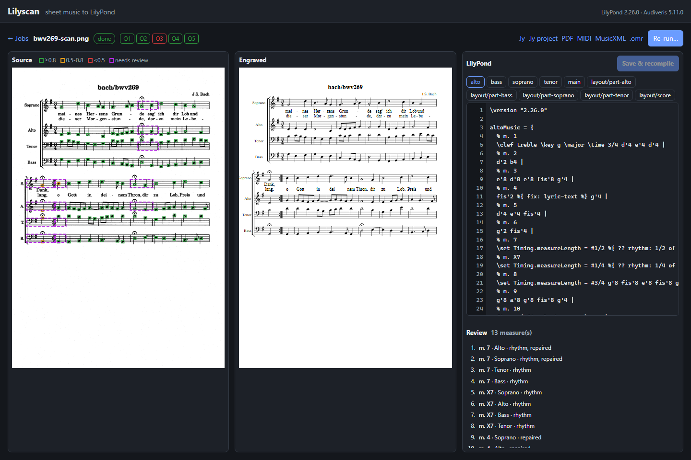
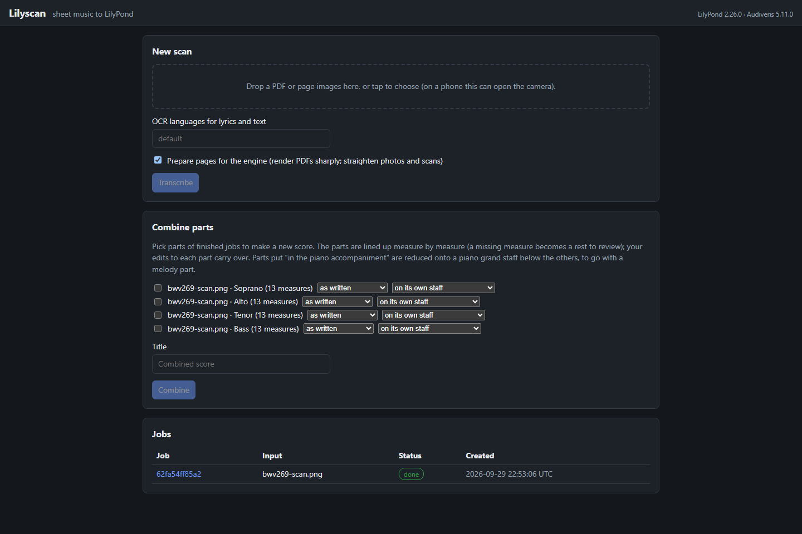
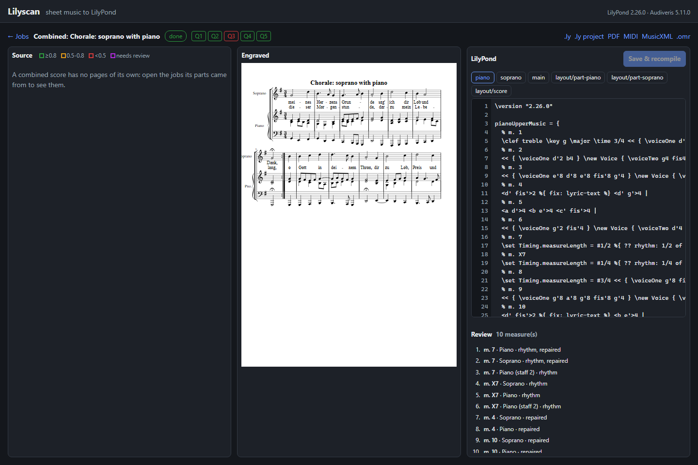

# Lilyscan

Sheet music in, editable LilyPond out. Lilyscan takes a born-digital PDF, a scan, or a phone
photo of printed music, reads it with the [Audiveris](https://github.com/Audiveris/audiveris)
optical music recognition (OMR) engine, repairs what the engine commonly gets wrong, and
writes a clean LilyPond project with the full score and every part. A browser UI shows the
page, the engraved result and the source side by side, so the measures that need a human
look can be found, fixed and recompiled in a minute.



**Status:** working end to end on one machine, in daily use on a library of real scanned
string parts. On the evaluation corpora about 83% of measures come out exactly right before
any human review (born-digital PDFs 89-92%, PNGs 83-88%, scans 83%, phone photos 72-74%);
see `eval/results/` and the status log in [docs/design.md](docs/design.md). What Audiveris
misreads is reported and fixed upstream where possible (see
[docs/upstream/audiveris](docs/upstream/audiveris/README.md)).

## What it does

- **Reads any kind of page.** Born-digital PDFs are rendered sharply at 400 DPI, and their
  printed tuplet numbers are used to check the rhythm. Photos and scans are straightened
  first: the page is found and seen head-on, uneven light is evened out, sideways or
  upside-down pages are turned upright, and curled or skewed staff lines are made straight.
  A scan is also read as uploaded, and Lilyscan keeps whichever result it expects to be
  better.
- **Repairs the engine's common mistakes** and says so: parts split between systems,
  key signatures misread on one system or in one part, tenor clefs read without their 8,
  missed triplets, dots and rests, multi-measure rests, page text or chord names read as
  lyrics, syllables read as one word. Each fix is listed in the review and noted in the
  source as a `% fix:` comment.
- **Tells you where to look.** Every note gets a calibrated confidence (a note at 0.7 is
  right about 70% of the time). Notes below 0.5 are marked in the source as `%{ ?? %}`, and a
  review list ranks the measures by what is wrong with them.
- **Writes real LilyPond.** One variable per staff, one line per measure with a bar check
  and a `% m. N` comment, absolute pitches, and layouts for the score and each part. The
  `.ly` download is a single file that engraves the score and each part.
- **Combines parts** read separately (a violin part and a cello part scanned on their own)
  into one score, lined up measure by measure, with transposition and concert pitch for
  transposing instruments. Parts can also be **reduced onto a piano accompaniment** below a
  melody part.
- **Exports** PDF, MIDI, MusicXML (for other notation programs) and the Audiveris project.

## How it works

A job goes through these stages (the design, and why each exists, is in
[docs/design.md](docs/design.md)). The paths are the Python reference implementation; the
Java port has the same stages under `lilyscan-core/src/main/java/org/lilyscan/core/`:

| Stage | What happens | Code |
|---|---|---|
| 0. Ingest | Every page of every upload, in order, becomes one book for the engine | `lilyscan/ingest/` |
| 1. Prepare | Photos and scans are found, straightened, turned upright and cleaned | `lilyscan/prepare/` |
| 2. Engine | Audiveris 5.11.0 transcribes the book (batch mode; a failed page is left out and the rest read again) | `lilyscan/engine/audiveris/runner.py` |
| 3. Import | The exported MusicXML becomes Lilyscan's score model, with page positions and grades from the Audiveris project | `lilyscan/ir/musicxml.py`, `lilyscan/engine/audiveris/omr.py` |
| 4. Vector oracle | Born-digital PDFs: glyphs read from the PDF itself check tuplets | `lilyscan/vector/` |
| 5. Repair | Rule-based repairs, then Lilyscan's calibrated confidence | `lilyscan/repair/` |
| 6. Score model | Parts, staves, measures, voices, events, with provenance for every change | `lilyscan/ir/models.py` |
| 7. LilyPond | The editable project, compiled to PDF, MIDI and SVG | `lilyscan/lilypond/` |
| 8. Checks | Compiles (Q1), bar checks (Q2), measure durations (Q3), ranges (Q4), parts line up (Q5), no lyrics in instrumental parts (Q9) | `lilyscan/qa/` |

Combining parts (`lilyscan/combine.py`) aligns the parts measure by measure
(`lilyscan/align.py`), lets parts that disagree on the key vote, optionally reduces some of
them to a piano accompaniment (`lilyscan/arrange.py`), and produces a new job.

## Project layout

```
lilyscan-core/       the pipeline (stages above), score model, LilyPond writer, repairs, Stage 1
lilyscan-engine/     Audiveris run in-process inside a separate worker JVM
lilyscan-server/     the web server (Javalin), job store (SQLite) and job steps
lilyscan-eval/       corpus scoring and confidence fitting
lilyscan-cli/        the command line (`serve`, `convert`, `eval`, ...); builds lilyscan.jar
lilyscan-desktop/    the desktop app (Swing): the review in a window, on this computer or a server
services/web/        the browser UI (plain HTML, CSS and JavaScript, no build step)
third_party/         Audiveris 5.11.0 (git submodule)
lilyscan/            the Python reference implementation: corpus generation and parity references
eval/                corpus specs (seed.json, repertoire.json) and committed results
docs/                design.md (design and status log), upstream/audiveris (bug reports and fixes)
tests/               parity references for the Java port, and the Python test suite
docker/              the image (Dockerfile, entrypoint, OCR model checksums)
packaging/linux/     the desktop app's .deb and .rpm (package.sh)
docker-compose.yml   the Docker deployment: one service
```

## Install

Lilyscan is one Java program, `lilyscan.jar`, with Audiveris built in. It needs LilyPond and
the Tesseract OCR models next to it. There are two ways to run it:

- **With Docker** (the simplest): Docker is the only thing to install. The image carries the
  server, Audiveris, LilyPond and the OCR models at the pinned versions.
- **Natively**: Java 25, LilyPond and the OCR models installed on the machine itself.

Either way the jar is built from source for now (a published image is planned). Building it
needs a JDK 25 and the Audiveris submodule:

```bash
git clone --recurse-submodules https://github.com/vilpter/lilyscan-desktop.git
cd lilyscan-desktop
LANG=C.UTF-8 ./gradlew :lilyscan-cli:shadowJar
```

The jar is `lilyscan-cli/build/libs/lilyscan.jar` (about 120 MB). Run the build again after
`git pull`. If the clone was made without `--recurse-submodules`, run
`git submodule update --init` first.

### With Docker

You need Docker Engine with the Compose plugin, or Docker Desktop. The image is built for
x86-64 Linux (`linux/amd64`). [Install Docker](https://docs.docker.com/engine/install/), build
the jar (above), then:

```bash
docker compose up -d --build
```

Then open <http://localhost:8000/>. Jobs are kept in the Docker volume `lilyscan-data`.

- **Check:** `docker compose ps` shows the service. `docker compose logs -f` follows its log.
- **Update:** `git pull`, build the jar again, then `docker compose up -d --build`.
- **Stop:** `docker compose down`. The jobs are kept; `docker compose down -v` deletes them
  too.
- **Port:** `LILYSCAN_PORT=8080 docker compose up -d`.
- **OCR languages:** English, Latin, German and French are in the image. Other languages named
  in `LILYSCAN_OCR_LANGUAGES` (say `eng+ita`) are downloaded once at startup and kept in the
  volume `tessdata-cache`; a custom `*.traineddata` placed there is used too.
- **Memory:** each Audiveris run gets a JVM heap of `AUDIVERIS_MAX_HEAP` (default `3G`).

### Natively

Lilyscan runs on Linux and Windows (macOS should work, but is untested). You need:

| Tool | Version | Notes | Ubuntu |
|---|---|---|---|
| Java | 25 | a JDK to build the jar; a JRE is enough to run it | [steps](#java) |
| [LilyPond](https://lilypond.org/download.html) | 2.26.0 | `lilypond` on the `PATH`, or `LILYPOND_BIN` | [steps](#lilypond) |
| Tesseract language models | [tessdata](https://github.com/tesseract-ocr/tessdata) (not `tessdata_fast`) | `eng`, `lat`, `deu` and `fra` by default, in the folder named by `TESSDATA_PREFIX`. Without them Audiveris reads no lyrics or titles | [steps](#ocr-models) |

Audiveris is inside the jar; it needs no install of its own. It needs the full OCR models with
the legacy engine: `tessdata_fast` and distribution `tesseract-ocr-*` packages do not work.
The versions are pinned: Lilyscan is tested against exactly these.

#### On Ubuntu

These steps are for Ubuntu 24.04 or later on x86-64. Run each block in a terminal; each one
is safe to run again. First:

```bash
sudo apt install git curl
```

##### Java

```bash
sudo apt install openjdk-25-jdk
java -version
```

If your Ubuntu has no `openjdk-25-jdk` package, install
[Eclipse Temurin 25](https://adoptium.net/installation/linux/) instead.

##### LilyPond

Ubuntu's own `lilypond` package is too old (2.24), so this installs the official 2.26.0 build
in `/opt`. It takes precedence over the Ubuntu package if that is installed too.

```bash
cd /tmp
curl -fLO https://gitlab.com/lilypond/lilypond/-/releases/v2.26.0/downloads/lilypond-2.26.0-linux-x86_64.tar.gz
sudo tar -xzf lilypond-2.26.0-linux-x86_64.tar.gz -C /opt
sudo ln -sf /opt/lilypond-2.26.0/bin/lilypond /usr/local/bin/lilypond
hash -r
lilypond --version
```

The last line should print `GNU LilyPond 2.26.0`.

##### OCR models

```bash
sudo mkdir -p /usr/local/share/tessdata
for lang in eng lat deu fra; do
  sudo curl -fL -o /usr/local/share/tessdata/$lang.traineddata \
    https://github.com/tesseract-ocr/tessdata/raw/main/$lang.traineddata
done
grep -q TESSDATA_PREFIX ~/.profile || echo 'export TESSDATA_PREFIX=/usr/local/share/tessdata' >> ~/.profile
```

Log out and back in, so that `TESSDATA_PREFIX` is set.

Then build the jar (above) and check the tools:

```bash
java -jar lilyscan-cli/build/libs/lilyscan.jar versions
java -jar lilyscan-cli/build/libs/lilyscan.jar selftest
```

`versions` compares the installed LilyPond and the bundled Audiveris with the pinned ones;
`selftest` compiles a small score.

## Start

Natively:

```bash
java -jar lilyscan-cli/build/libs/lilyscan.jar serve
```

Then open <http://localhost:8000/>. `--port` changes the port and `--data` the folder where
jobs are kept (default `./data`). Jobs run inside the server: Audiveris in a separate JVM per
run, so a crash or a runaway page cannot take the server down.

With Docker: `docker compose up -d --build` ([above](#with-docker)).

## Use

### Transcribe



1. **Upload** a PDF or page images on the home page (on a phone this can open the camera).
   Pages are prepared for the engine unless you untick the option. The OCR languages for
   lyrics and text can be changed per upload.
2. **Follow** the job: preparing pages, the engine (about a minute a page), repairs, LilyPond
   and checks. A page Audiveris cannot read is left out, and the job's report says which.
3. **Review** in three panes. **Source** shows the page as the engine read it, every note
   boxed green, amber or red by confidence and the measures that need attention outlined.
   **Engraved** shows the LilyPond output. **LilyPond** is the editable source, with the
   review list of measures ranked by problems. Clicking a measure in any pane, or putting the
   caret on its line, highlights it in the other two. The badges Q1-Q5 and Q9 show the checks.
   When a part named for an instrument has lyrics (Q9), usually a title or a note read as
   lyrics, **Drop these lyrics** stops engraving them.
4. **Edit** the source and press **Save & recompile**.
5. **Download** the result:
   - `.ly`: one file that engraves the score and each part. Compiling `piece.ly` gives
     `piece-score.pdf` and one PDF per part.
   - `.ly project`: the editable project (a file per part), as a zip.
   - PDF and MIDI of the score.
   - MusicXML: the score as transcribed and repaired, for other notation programs. Edits to
     the LilyPond source are not in it.
   - `.omr`: the Audiveris project, to open in the Audiveris application.

**Re-run** repeats a job with other settings (OCR languages, page straightening).

### Combine parts



**Combine parts** on the home page makes a new score from parts of finished jobs: say a
violin part and a cello part scanned separately.

- Each part can be transposed, or taken at concert pitch if it is a transposing instrument.
- Parts read separately seldom have exactly the same measures (the engine misses or adds one
  now and then), so they are lined up measure by measure. Where a part has no measure it gets
  a rest that shows in the review list. Parts that disagree on the key signature (one read
  wrongly throughout) take the key the others read.
- Your edits to each part carry over: the new score includes the parts' own LilyPond sources,
  and transposition is done by LilyPond's `\transpose`, so those sources stay as written.
- A part can go **in the piano accompaniment** instead of on its own staff. The chosen parts
  are reduced onto a piano grand staff below the others, turning an ensemble arrangement into
  a melody with piano. Each part goes to the staff for the register it sounds in (a double
  bass an octave below where it is written). Parts playing the same rhythm merge into chords;
  others keep voices of their own.

The combined score is a job like any other: review it, edit it, download it.

### Desktop app

The same review, as a desktop window instead of a browser tab:

```bash
java -jar lilyscan.jar desktop                                # on this computer
java -jar lilyscan.jar desktop --server http://homelab:8000    # with a Lilyscan server
```

On this computer it starts the Lilyscan engine inside the app, and keeps the jobs in your
user data folder (`~/.local/share/lilyscan` on Linux, `%LOCALAPPDATA%\Lilyscan` on Windows,
`~/Library/Application Support/Lilyscan` on macOS; `--data` sets another). It needs LilyPond
and the OCR models as a native install does ([Natively](#natively)). With `--server`, or
**Connection > Lilyscan server...**, it works on the jobs of a server, such as the Docker one,
and needs nothing else installed. The app remembers the last choice.

**Installers.** On Linux the desktop app also comes as a `.deb` (Debian, Ubuntu) or `.rpm`
(Fedora, openSUSE) with everything inside: its own Java runtime, Audiveris, LilyPond 2.26.0 and
the OCR models for English, Latin, German and French. Nothing else needs installing; Java,
LilyPond and the models are not needed on the computer. Build one from the jar (needs `fakeroot`
for a `.deb`, `rpm` for a `.rpm`):

```bash
packaging/linux/package.sh deb    # or: rpm, app-image
sudo apt install ./build/packaging/out/lilyscan_*_amd64.deb
```

It installs to `/opt/lilyscan` with a menu entry **Lilyscan** (or run
`/opt/lilyscan/bin/Lilyscan`); `sudo apt remove lilyscan` removes it, and keeps your jobs. CI
builds both packages for every change to the app (`desktop-packages` workflow artifacts).
`LILYPOND_BIN` and `TESSDATA_PREFIX` still override the bundled LilyPond and models.

It does what the web UI does: upload (or drop files on the window), follow a job, review in
three panes with click-to-sync, edit and recompile, drop misread lyrics, re-run, combine parts,
and download every format. **Ctrl + mouse wheel** or the **- Fit +** buttons zoom the page and
the engraved score.

### Command line

```bash
java -jar lilyscan.jar convert score.mxl --out out/score
```

`convert` turns a MusicXML file (for example Audiveris output) into a LilyPond project with a
QA report. The other commands: `serve` (above), `desktop` (above), `versions`, `selftest` and
`eval` (below).
`java -jar lilyscan.jar <command> --help` shows the options.

### What a job keeps

A finished job's folder (under `data/jobs/<id>/`) holds:

- `prepared/`: `pages.tif` (every page as given to the engine, in upload order), `uploaded.tif`
  when some page is a scan, and `report.json` (what was done to each page, quality warnings).
- `engine/`: the Audiveris project, its MusicXML and log, and `run.json` (the command, which
  pages were left out and why, and which reading was kept).
- `ir/score.json`: the score model, with page boxes and confidence per event.
- `ly/`: the LilyPond project (`main.ly`, `parts/`, `layout/`) and the compiled PDF and MIDI.
- `score.musicxml`, `overlays/page-N.png` (each page with the notes boxed by confidence), and
  `report.json` (pages, engine run, geometry, repairs, checks Q1-Q5 and Q9).

### Configuration

Settings come from the environment:

| Variable | Default | Meaning |
|---|---|---|
| `LILYSCAN_DATA_DIR` | `data` | where jobs are kept (`serve --data` sets it) |
| `LILYSCAN_OCR_LANGUAGES` | `eng+lat+deu+fra` | Tesseract codes for lyrics and text; the Docker image downloads missing models at startup |
| `LILYPOND_BIN` | `lilypond` | the LilyPond executable |
| `AUDIVERIS_BIN` | | an external Audiveris to run instead of the bundled one (for testing) |
| `AUDIVERIS_MAX_HEAP` | `3G` | the JVM heap of each Audiveris run |
| `TESSDATA_PREFIX` | | the folder with the Tesseract models |
| `AUDIVERIS_TIMEOUT_S`, `AUDIVERIS_TIMEOUT_PER_PAGE_S` | 900, 240 | an engine run may take the larger of the two (the second per page) |
| `AUDIVERIS_STEP_TIMEOUT_S` | 300 | one engine step on one page (Audiveris's own default is 120) |
| `LILYPOND_TIMEOUT_S` | 120 | one LilyPond compile |

## Develop

```bash
LANG=C.UTF-8 ./gradlew build
```

builds every module and runs the Java tests, including the parity tests against the Python
references committed in `tests/parity/`. Larger local sweeps compare the two implementations
on the whole corpus (`-PengineSweep`, `-PprepareSweep`, `-PcombineSweep`, `-PevalSweep`; see
`scripts/java_*_sweep.py`).

The Python implementation stays as the reference the parity tests compare against:

```bash
uv sync --all-extras
uv run pytest -m "not gpu and not engine"
uv run ruff check . && uv run ruff format --check . && uv run mypy
```

Tests marked `lilypond` need LilyPond and `engine` tests need Audiveris (`AUDIVERIS_BIN` and
`TESSDATA_PREFIX`). Missing tools cause a skip, not a failure. Each change goes on a branch and
a pull request; CI builds the jar, runs both test suites, builds the image and transcribes a
page in it. Changing a pinned tool version is a change of its own: update the pins, the
Dockerfile and the Audiveris submodule, then re-run the evaluation.

### Evaluation

Three corpora measure every change against ground truth, each built from a committed spec:

- **Seed** (`eval/corpus/seed.json`): random but valid music in six categories (solo, piano,
  choir, lead sheet, quartet, song) with exact MusicXML, engraved with LilyPond, then degraded
  to simulated scans and photos.
- **Repertoire** (`eval/corpus/repertoire.json`): excerpts of public-domain works from
  music21's corpus, with each work's rights recorded in the manifest.
- **OpenScore** (`eval/corpus/openscore.json`): excerpts of CC0 works from
  [OpenScore Lieder](https://github.com/OpenScore/Lieder) (songs for voice and piano in German,
  French and English, from where the voice enters) and
  [OpenScore String Quartets](https://github.com/OpenScore/StringQuartets).

Real works are fetched once, at pinned revisions, into `eval/corpus/cache/`:

```bash
java -jar lilyscan.jar corpus build
java -jar lilyscan.jar corpus build --spec eval/corpus/repertoire.json
java -jar lilyscan.jar corpus build --spec eval/corpus/openscore.json
```

The Java builder writes the same seed pieces as the Python one (`uv run lilyscan corpus build`,
which also still builds the seed and repertoire corpora): its random draws reproduce Python's
exactly, and a test compares every piece note for note. The simulated scans and photos use
Java's own random numbers, so they differ from Python's in detail; compare a Java-built corpus
with the `java-*` baselines.

```bash
java -jar lilyscan.jar eval run --repair --prepare --label my-run
java -jar lilyscan.jar eval run --corpus eval/corpus/repertoire --repair --prepare --label my-run-rep
```

Results go to `eval/results/<label>/` (`summary.md`, `results.json`), and Audiveris's output is
cached in `eval/work/`, so later runs only re-score. The summary reports exact-measure
accuracy, edit rate, note F1, lyric and chord accuracy, how many engine events were located
on the page, and how well confidence is calibrated.

The current baselines are `base-1031-seed` and `base-1031-rep`: fresh engine runs on Linux
(Ubuntu, x86-64) with `--repair --prepare --lilypond`. `base-1014-seed` and `base-1014-rep` are
the same code's results on Windows. Audiveris reads a few pages slightly differently there, so
compare with the baseline from the same platform, item by item in `results.json`.

- `--repair` applies Lilyscan's repairs and confidence before scoring, and lists every repair.
- `--prepare` sends scans and photos through Stage 1 first, as a job does.
- `--lilypond` also generates LilyPond and reports how often it compiles (Q1) and passes bar
  checks (Q2).
- New engine runs need the OCR models (`TESSDATA_PREFIX`).

After changing a repair rule or adding corpus pieces, refit the confidence model (it rewrites
`lilyscan/repair/confidence.json` and prints the calibration error per corpus):

```bash
java -jar lilyscan.jar eval calibrate
```

## License

AGPL-3.0-or-later, like Audiveris. See [LICENSE](LICENSE). Every model, dataset and library
Lilyscan uses must be AGPL-compatible ([docs/design.md](docs/design.md), decision D12).
